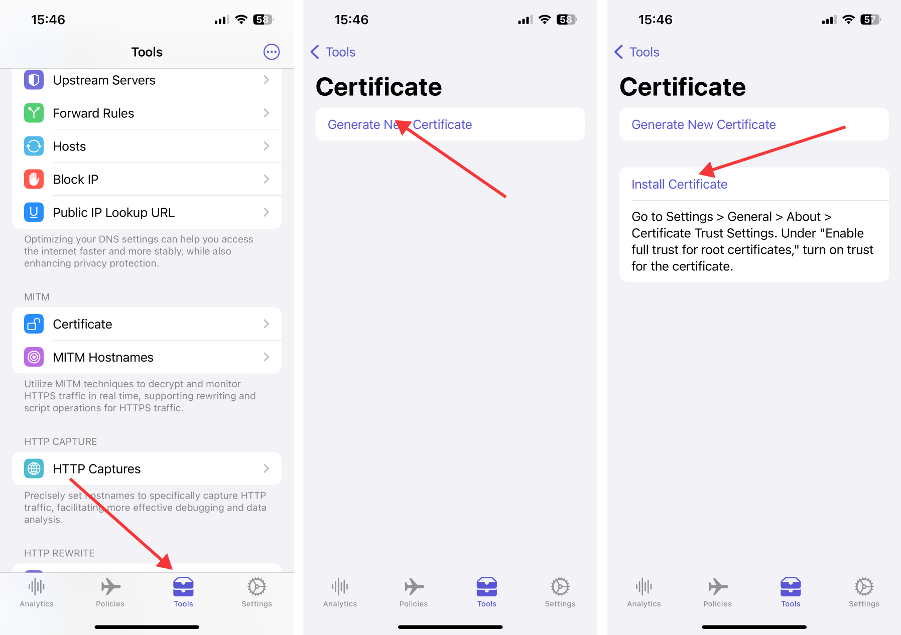
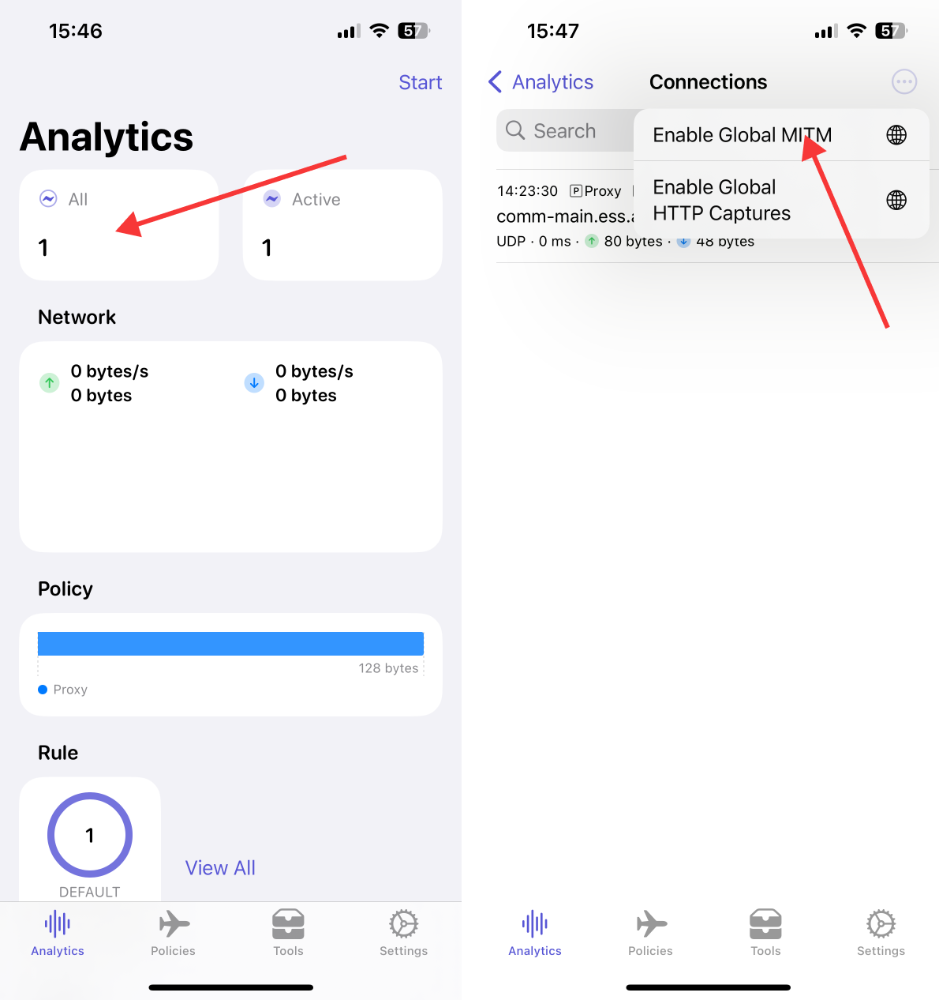
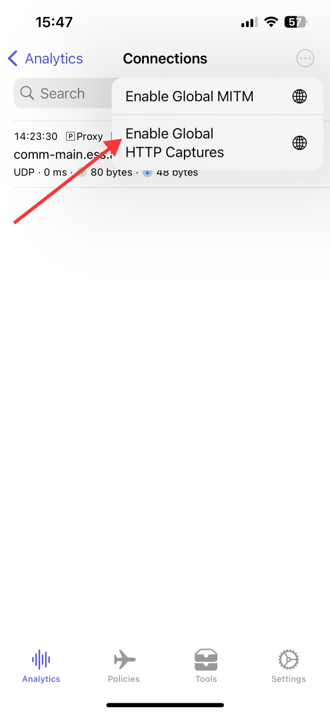

# Egern as HTTP traffic sniffer

Egern is a tool that can be used to capture and analyze HTTP request and response data in network transmissions, which can help diagnose network application issues, monitor data transmission, and perform network security analysis.

## Configure Root Certificate

Tap `Tools` -> `Certificate` -> `Generate New Certificate` -> `Install Certificate`

## Enable Global MITM

Tap `All` -> `...` -> `Enable Global MITM`

## Enable Global HTTP Captures

Tap `All` -> `...` -> `Enable Global HTTP Captures`

