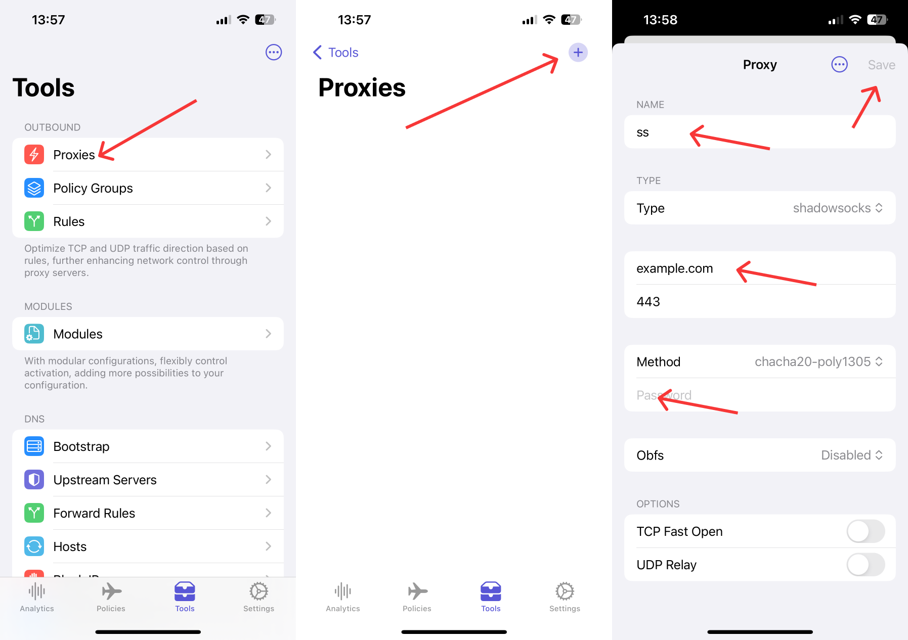
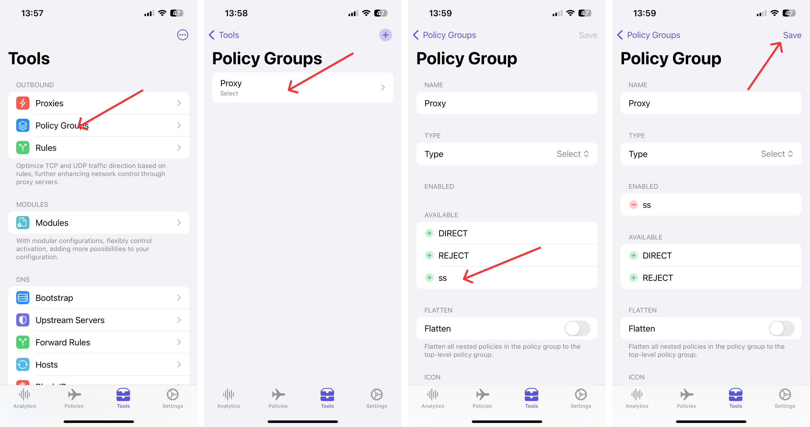
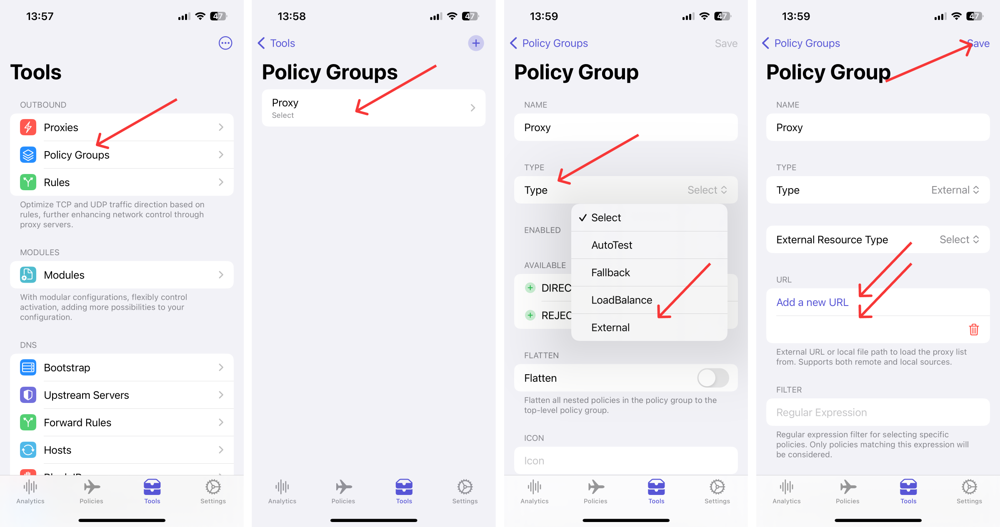

# Egern as a Proxy Tool

Egern can serve as a proxy tool to route network traffic. The following examples demonstrate how to add a proxy server and use a remote proxy subscription.

## Using a Proxy Server

### Adding a Shadowsocks Proxy Server

Click `Tools` -> `Proxies` -> `+`, fill in `Name`, `Server`, `Port`, `Method`, and `Password`, then click Save.

### Adding the Proxy Server to a Policy Group

Click `Policy Groups` -> `Proxy` -> `ss` -> `Save`.

## Using a Remote Proxy Subscription URL

### Changing Proxy to an External Policy Group

Click `Policy Groups` -> `Proxy` -> `Type` -> `External` -> `Add New URL`, enter the remote proxy's URL address, and click `Save`.

